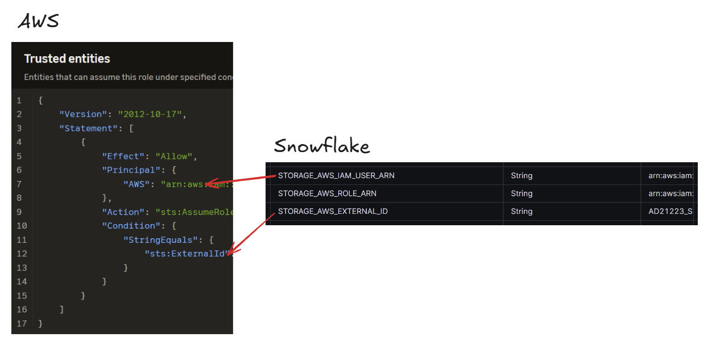

# Amplitude Project

The Amplitude Project is using Amplitude's Export API (https://amplitude.com/docs/apis/analytics/export) to bring back data of the TIL website interactions.

This data includes PII, such as IP addresses, geographical data, to user IDs and therefore have not been committed to the repo.

This particular script brings back website traffic data from the previous day with considerations as to bringing back any missing data. This is the loaded into an S3 bucket on our AWS account and loaded into Snowflake.

Then, this data can then be used to understand how visitors use our website. Allowing further understanding behaviours and identify potential pain points and hotspots to configure our website further.

# Table of Contents
### 1. [Extract](#extract)
### 2. [Load](#load)
### 3. [Orchestration](#orchestration)
### 4. [Transform](#transform)

# Extract 
This stage of the project was used to consolidate understanding of Python, combining separate elements from various Python projects we had done over the few days to call the API and to save that data locally.
#### [Back to contents](#table-of-contents)

## Getting Started

First, all documentation should be read: https://amplitude.com/docs/apis/analytics/export

This provides a better understanding of the API and how it works, and this then helps with planning and accommodating.

### Setting up the project

First we need to create a new branch:

```python
git switch -c extract-branch
```

Then create the virtual environment and activate it:

```python
python -m venv .venv

.venv/Scripts/activate
```

Then all required packages can be installed, we will need requests (to call the API) and the dotenv package (to call the .env file):

```python
pip install requests

pip install python-dotenv
```

Next up is to create the .env file and putting the AMP API and AMP key in there. Then in the console running the pip freeze command to generate the requirements.txt document. 

```python
pip freeze > requirements.txt
```
By creating this document, we will be able to refer back to it to install all required packages using a command.


### Getting into the code


# Load

This stage of the project was focused on familiarising ourselves with AWS and the loading capabilities Snowflake has. Our task was to set up the S3 bucket alongside a policy, role and user, code the Python to push data from our local to the S3 bucket, and then load it into our Snowflake environment.

#### [Back to contents](#table-of-contents)

### AWS
As we have a company-wide account, we have our own environment to create the S3 bucket, policy, role and user in.

First we needed to create the S3 bucket using SSE-KMS encryption (in this interface we were also able to create the KMS key for this encryption type). Since our usecase is quite simple most of the default options were used, but in business contexts version control can be useful (though more costly).

Then we went to the IAM portal and created the policy for the S3 bucket and the KMS key:

|<div style="width:70px">Object</div>| <div style="width:200px">List</div>                                     | <div style="width:200px">Read</div>           | <div style="width:200px">Write</div>                                 |
|--------|-------------------------------------------|---------------|---------------------------------------|
| S3     | <li>listbucket</li><li> listbucketmultipartuploads |<li>getobject   |<li>deleteobject</li><li>putobject            |
| KMS    |                                           | <li> describekey |<li>decrypt</li><li>encrypt</li><li>generatedatakey |
|        |                                           |               |                                       |

To simplify the process, the policy was applied to both the user (Python) and role (Snowflake).

For the user, the AWS access key and secret access key were put straight into the existing .env file with the role being used for 'Local code'.

For the role, the role type was AWS account with a temporary External ID of 0000, which was to be replaced with an ID generated within Snowflake. This we will return to after the Python section. [Click here to skip ahead to the Snowflake section.](#snowflake-code)

### Python
#### Setting Up
Since this is a new stage of the process, a new script should be made. This means that any work from the old branch should be committed back to the main, merged, and then pulled to keep the main up to date.

A new branch for loading needs to be made:

```python
git switch -c load-extract
```
And to interact with the AWS services, we'll need to install another package and update the requirements.txt file.
```python
pip install boto3

pip freeze > requirements.txt
```
After getting to this stage, the changes should be added and commited as initial set up.
```python
git add -

git commit -m 'completed initial setup'
```

#### Writing the script
First a new file should be made (name it something sensible!) and all packages required should be imported.
```python
import os
import json
import logging
from datetime import date
from dotenv import load_dotenv
import boto3
```
What is super important is that we input the command to initialise Python's ability to access the .env file we made (this is something I forgot to do in my test script when trying to figure out the loop).
```python
load_dotenv()
```
As with best practices, the logging should be set up as soon as possible, but of course can always be added in after coding the bulk of the script:
```python
#making logging directory*
log_dir = 'logs'
os.makedirs(log_dir, exist_ok=True)
#setting what the file name for logging should be
log_filename = f'{log_dir}/{date.today()}.log'

logging.basicConfig(
    #using the variable we created above
    filename = log_filename,
    #setting the layout of the log record
    format = '%(asctime)s - %(levelname)s - %(message)s',
    #defining the level of detail we want called back
    level = logging.INFO
)

logger = logging.getLogger()
#putting a message in the log to show that it was successful
logger.info('logger was successfully initialised')
```
Since we will be uploading the unzipped json files from our local storage, we need to define the data directory, as well as get the file names from that directory.
```python
#name of the folder that the jsons live in
data_dir = 'data_zip'
#using the os package to list the name of the files within the defined directory
file_names = os.listdir(data_dir)
```
With all of the file set up and definitions created for the upload loop, we can set up what Python needs to access AWS and the S3. 

We will need to:
- Get the access key, secret access key, and bucket name from the .env file
- Use the boto3 package to define the session, using the aforementioned credentials
```python
#defining aws credentials for session using the variables within the .env file
AWS_ACCESS_KEY=os.getenv('AWS_ACCESS_KEY')
AWS_SECRET_KEY=os.getenv('AWS_SECRET_KEY')
AWS_BUCKET=os.getenv('AWS_BUCKET')

s3_client = boto3.client(
    #service that will be accessed
    's3',
    #credentials
    aws_access_key_id = AWS_ACCESS_KEY,
    aws_secret_access_key = AWS_SECRET_KEY
)
```
If there are any errors in the log, check if ```load_dotenv()``` is in the script, try and print the values. Otherwise there may be issues with the keys - so you will need to generate a new set in the AWS role and deactivate the set that does not work.

In order to get the files uploaded, we will need the script to look at what files are existing in our local directory and upload them one by one. Then afterwards the files should be deleted.
```python
#the name of the jsons [file] within the list of file names generated using os.listdir(data_dir) [file_names]
for file in file_names:
    #creating a string variable using the name of the folder and the file name e.g. 'data_zip/20261111.json'
    to_upload = f'{data_dir}/{file}'
    try:
        #function, location of file locally, bucket namee, name of the file to be uploaded
        s3_client.upload_file(to_upload, AWS_BUCKET, file)
        print(f'file {file} successfully uploaded! 🥳')
        logger.info(f'file {file} successfully uploaded!')
        #removing uploaded files
        os.remove(to_upload)
        logger.info(f'file {file} was deleted locally')
    except Exception as e:
        print(f'something went wrong 🫪, error {e}')
        logger.error(f'something went wrong, error {e}')
```
With the coding done, we can now move to the Snowflake (and minimal AWS!) side.
### Snowflake
#### Setting Up
To set up, we'll need to create a schema within our warehouse. This can be done by going to the catalog -> selecting our desired warehouse and clicking create schema button.


Then in a new file (in a new workspace to keep things neat!), we'll need to create a SQL script for storage and loading in the table.
```SQL
create storage integration /*{name the integration - this will be public for everyone in the warehouse to see}*/
    type = external_stage
    storage_provider = S3
    enabled = true
    storage_aws_role_arn = /*{the role arn in '' marks}*/
    storage_allowed_locations = (/*/{the link to the s3 bucket in ''}'*/)
  ```
After this is made, we will then need to run code to get the external ID needed on the AWS side. <a id="snowflake-code"></a>
```sql
desc integration /*name of storage integration from previous block*/
```
This should bring back a table within your terminal, pay attention to the STORAGE_AWS_IAM_USER_ARN and STORAGE_AWS_EXTERNAL_ID as you will need to copy these into the policy code.



#### What I learnt:
<ul><li>ARN numbers are useful to connect different services to one another
<li>Permissions in a policy are very detailed and customisable
<ul><li> So always double check documentation when setting policies up if there are certain capabilities required for a user/ system to interact
